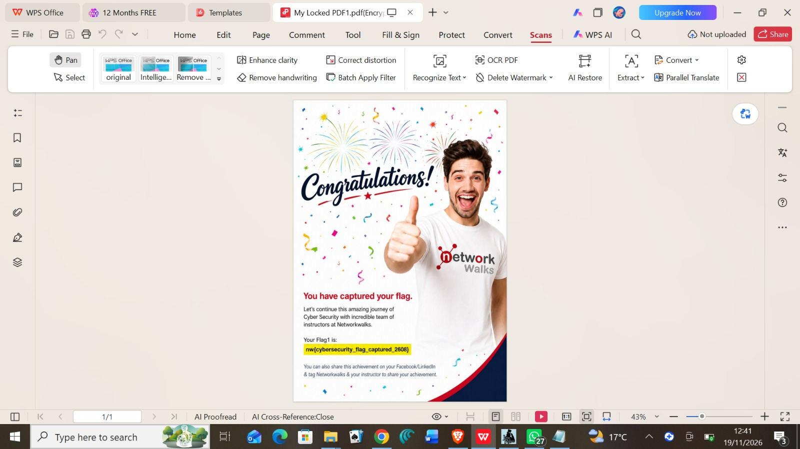
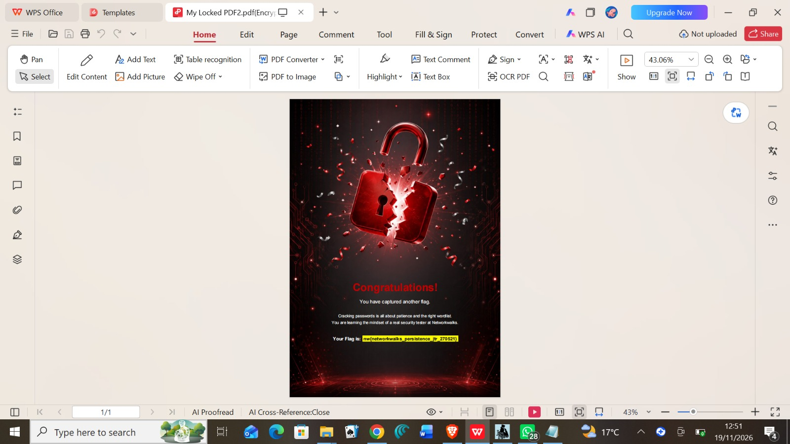
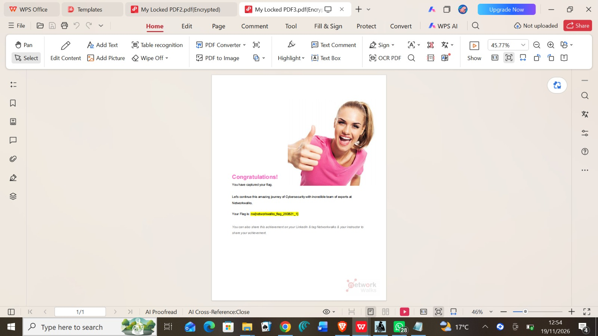

<div align="center">

# 🔐 Password Cracking Lab

### Week 3 · Networkwalks Cybersecurity Internship

<a href="https://github.com/"></a>
<a href="https://www.openwall.com/john/"></a>
<a href="#lab-overview"></a>

<br>


</div>

> ⚠️ **Educational use only:** This lab was performed on files supplied by Networkwalks, with explicit permission. Never attempt to crack files, accounts, or systems without authorization.

<a id="lab-overview"></a>

## 📌 Lab overview

| Item | Details |
|---|---|
| **Internship** | Cybersecurity & Ethical Hacking @ Networkwalks |
| **Modules** | W3-PM1 · W3-PM2 |
| **Objective** | Compare two authorized methods for recovering passwords from protected PDF files |
| **Status** | ✅ Completed |
| **Wordlist** | `rockyou.txt` |

### 🎯 What I practiced

- Extracting a crackable PDF hash with `pdf2john`
- Recovering a weak password with John the Ripper
- Validating the result with Networkwalks' browser-based tools
- Understanding why dictionary passwords are unsafe

## 🧰 Tools used

<div align="center">

| Tool | Purpose |
|---|---|
| 🐉 **John the Ripper** | Command-line password recovery on Kali Linux |
| 🖥️ **Johnny GUI** | Windows graphical alternative |
| 🧮 **Networkwalks Hash Calculator** | Extracted the PDF hash in the browser |
| 🔓 **Networkwalks Password Cracker** | Tested the extracted hash against a built-in list |
| 📚 **rockyou.txt** | Dictionary wordlist used for the JTR exercise |

</div>

## 🧪 Method 1 · W3-PM1 — John the Ripper

<details open>
<summary><strong>View the command-line workflow</strong></summary>

1. Opened `My Locked PDF1.pdf` and confirmed that it was password protected.
2. Extracted the PDF hash:

   ```bash
   pdf2john "My Locked PDF1.pdf" > hash.txt
   cat hash.txt
   ```

   The hash begins with `$pdf$...`.

3. Cracked the hash with the RockYou wordlist:

   ```bash
   john --wordlist=/usr/share/wordlists/rockyou.txt hash.txt
   john --show hash.txt
   ```

4. **Recovered password:** `password1`

</details>

## 🌐 Method 2 · W3-PM2 — Networkwalks tools

<details open>
<summary><strong>View the browser-based workflow</strong></summary>

1. Uploaded the PDF to **Networkwalks Hash Calculator → PDF**.
2. Confirmed the message: **“This PDF is encrypted. A crackable hash has been extracted.”**
3. Copied the `$pdf$...` hash into **Networkwalks Password Cracker → Built-in List (100 passwords)**.
4. Selected **START CRACKING**.
5. **Result:** `PASSWORD CRACKED SUCCESSFULLY`
6. Opened the PDF with `password1` and captured the flag:
   **“Congratulations! You have captured your 1st flag.”**

</details>

## 🖼️ Evidence gallery

All evidence images in this project are displayed below. Click any image to open the full-size version.

### John the Ripper evidence

<div align="center">
<a href="./evidence-PM1-JTR/My-unlocked-pdf1.jpeg"></a>
<a href="./evidence-PM1-JTR/My-unlocked-pdf2.jpeg"></a>
<a href="./evidence-PM1-JTR/My-unlocked-pdf3.jpeg"></a>
</div>

### Networkwalks tools evidence

<div align="center">
<a href="./evidence-PM2-NW-Tools/Networkwalks%20password%20cracking%20tools.jpeg"></a>
</div>

## 💡 Key learnings

1. A locked file is not automatically uncrackable: John needs the hash, not the original file.
2. Weak passwords such as `password1` commonly appear in wordlists and can be recovered quickly.
3. A strong password should be long, unique, random, and absent from dictionaries.
4. Cross-checking with two authorized tools increases confidence in the result.

## 🛡️ Defensive takeaway

Use long, unique passphrases, enable multi-factor authentication where available, and avoid reusing passwords. For sensitive documents, combine strong encryption with secure password sharing and storage.

<div align="center">

### ✅ Lab complete

<sub>Built for authorized cybersecurity learning · Networkwalks Week 3</sub>

</div>
